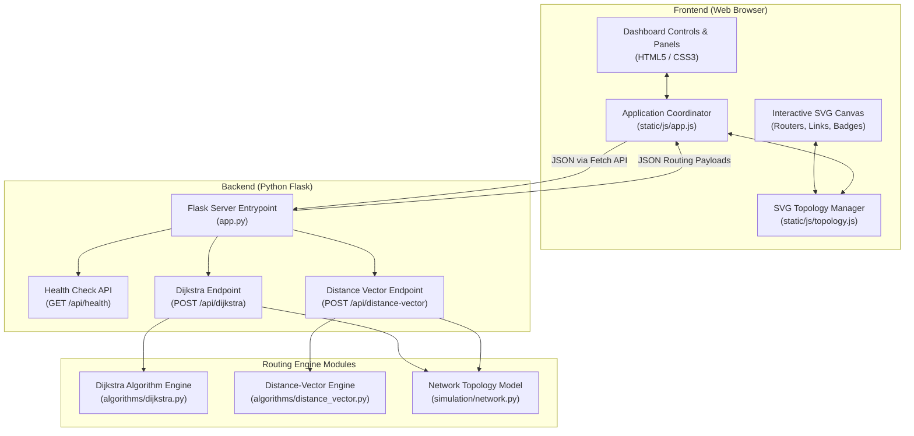
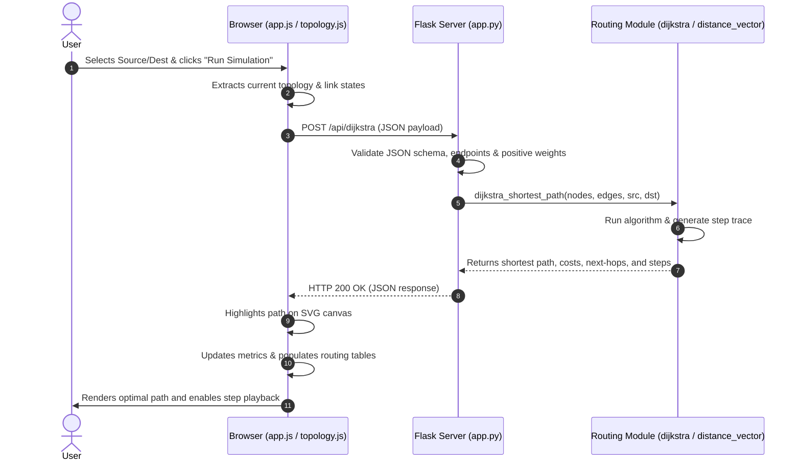
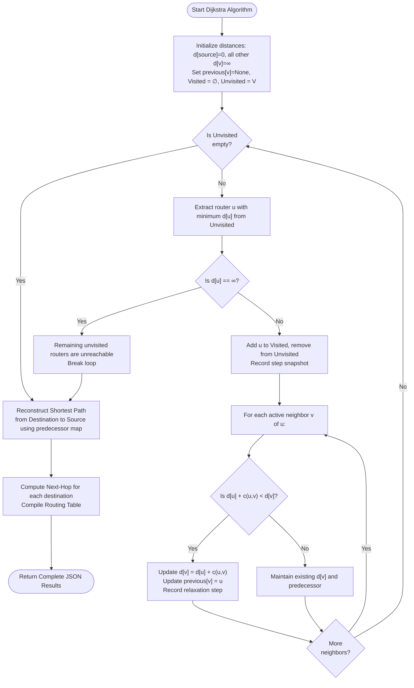
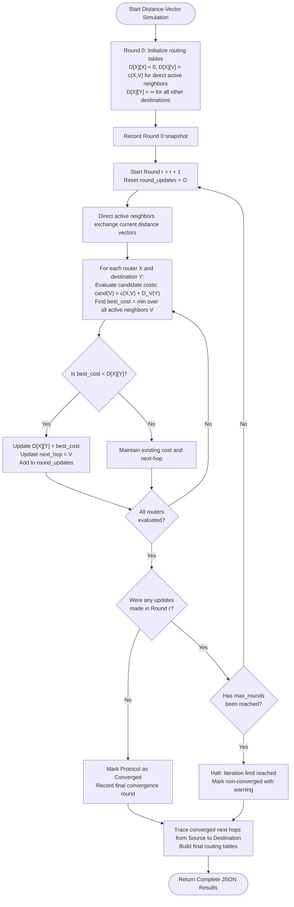

# College Project Report: Intelligent Network Routing Simulator

---

## 1. Title Page

**Project Title**: Intelligent Network Routing Simulator  
**Domain**: Computer Networking, Distributed Systems & Graph Algorithms  
**Academic Degree**: Bachelor of Technology / Bachelor of Engineering in Computer Science & Engineering  
**Technology Stack**: Python 3, Flask, Vanilla JavaScript (ES6), Native SVG, HTML5, CSS3, pytest  
**Implementation Mode**: Local Single-Page Web Application (SPA) with RESTful Backend  
**Academic Year**: 2025–2026  

---

## 2. Abstract

The **Intelligent Network Routing Simulator** is an interactive, educational network modeling and analysis application designed to simulate, visualize, and compare the two foundational routing paradigms of modern computer networking: **Link-State Routing (Dijkstra's Shortest Path Algorithm)** and **Distance-Vector Routing (Bellman-Ford Protocol)**. 

Built strictly using vanilla web technologies (HTML5, CSS3, ES6 JavaScript) and native Scalable Vector Graphics (SVG) on the frontend, and Python 3 with Flask on the backend, the simulator avoids reliance on third-party graph frameworks or databases. Users can construct arbitrary router topologies, assign weighted transmission costs, dynamically simulate transmission link failures and recoveries, and trace the algorithmic computation of routing tables in real time. 

Automated test suites written in `pytest` guarantee 100% algorithm fidelity, deterministic tie-breaking, graph immutability, and robust error handling.

---

## 3. Introduction

In modern packet-switched communication networks, routing protocols dictate the paths taken by packets traveling from source hosts to destination endpoints. These routing protocols operate within the Network Layer (Layer 3 of the OSI Model) and are broadly classified into two categories:
1. **Link-State Protocols** (e.g., OSPF, IS-IS): Each router builds a complete topological map of the entire network and independently calculates the shortest path tree using Dijkstra's algorithm.
2. **Distance-Vector Protocols** (e.g., RIP, BGP path-vector derivative): Each router possesses only local knowledge of directly attached neighbors and iteratively exchanges distance vectors to compute minimum-cost paths using the Bellman-Ford algorithm.

Understanding the behavioral trade-offs between centralized topological computation and distributed asynchronous vector exchange is critical for networking students. The Intelligent Network Routing Simulator provides a hands-on, visual laboratory environment where these algorithms can be observed, tested, and analyzed under healthy and degraded network conditions.

---

## 4. Problem Statement

Computer networking curricula traditionally teach routing algorithms through mathematical proofs, tabular blackboard examples, or command-line outputs. While industry-standard emulators like Cisco Packet Tracer and GNS3 exist, they present steep learning curves, proprietary licensing constraints, and heavy system overhead. 

Consequently, students frequently struggle to grasp:
- The exact sequence of node relaxations in Dijkstra's algorithm.
- How routing updates ripple across neighbor routers in Distance-Vector routing over successive rounds.
- How routing tables transition when a critical transit link fails.
- Why next-hop forwarding tables differ from end-to-end path strings.

There is a clear academic necessity for a lightweight, zero-configuration, interactive web application that executes genuine Python routing algorithms and visually demonstrates routing behavior in real time.

---

## 5. Objectives

1. **Native Interactive Topology Canvas**: Develop a zero-dependency SVG canvas allowing students to create, reposition (drag and drop), and interconnect router nodes with weighted links.
2. **Faithful Algorithm Implementations**: Implement Dijkstra's algorithm and the Distance-Vector protocol in isolated Python modules without using pre-packaged routing or graph libraries.
3. **Dynamic Fault Simulation**: Enable real-time simulation of link cuts and restorations to demonstrate dynamic re-routing and partitioned network detection.
4. **Step-by-Step Algorithm Playback**: Provide visual controls (`Next Step`, `Prev Step`) to walk through individual node relaxations and round-by-round vector exchanges with plain-language explanations.
5. **Real-Time Routing Table Generation**: Automatically calculate and display standard forwarding tables (`Destination`, `Cost`, `Next Hop`, `Status`) for all routers.
6. **Educational Rigor & Verification**: Deliver a comprehensive automated test suite verifying edge cases, input validation, and algorithm equivalence.

---

## 6. Existing Systems and Limitations

| System | Architecture | Major Limitations |
|---|---|---|
| **Cisco Packet Tracer** | Proprietary Desktop Application | Heavy installation footprint; closed-source; complex CLI configuration; non-trivial setup for simple algorithmic tracing. |
| **GNS3 / EVE-NG** | Virtualized Emulation Platform | Requires virtual machines, Cisco IOS binary images, and substantial RAM/CPU resources; steep learning curve. |
| **Textbook Matrix Tracing** | Static Paper / Whiteboard | Static snapshots; cannot visualize dynamic link failure, re-convergence, or larger topologies in real time. |
| **Third-Party Web Visualizers** | Generic Canvas / D3.js Toys | Often use hardcoded dummy graphs or client-side approximations without real network protocol modeling or forwarding tables. |

---

## 7. Proposed System

The proposed simulator resolves these limitations by delivering:
- **Zero-Dependency Architecture**: Runs on any modern browser connecting to a local Python Flask server with zero external libraries.
- **Pure Algorithm Separation**: All graph mathematics and vector calculations execute on the Python backend; the frontend focuses purely on native SVG rendering.
- **True Network Layer Forwarding**: Generates authentic routing tables containing next-hop interfaces rather than merely displaying path lines.
- **Full Failure Simulation Lifecycle**: Allows interactive link disabling, immediately invalidates stale paths, and recomputes valid alternative routes or marks partitioned destinations as unreachable.

---

## 8. Software and Hardware Requirements

### Software Requirements
- **Operating System**: Microsoft Windows 10 / 11 (64-bit)
- **Python Runtime**: Python 3.10, 3.11, or 3.12
- **Backend Libraries**: Flask 3.1.3, pytest 9.1.1, Werkzeug 3.1.9, Jinja2 3.1.6
- **Web Browser**: Google Chrome, Mozilla Firefox, or Microsoft Edge (supporting HTML5, CSS3, ES6 JavaScript, and SVG)

### Hardware Requirements
- **Processor**: Intel Core i3 / AMD Ryzen 3 or higher
- **RAM**: Minimum 512 MB (1 GB recommended)
- **Storage**: Minimum 50 MB free disk space
- **Display Resolution**: 1366 × 768 or higher (optimized for laptops and desktops)

---

## 9. Technology Stack

```
Frontend: HTML5 Semantic Layout + CSS3 NOC Dark Theme + Vanilla ES6 JavaScript
Visualization: Native Scalable Vector Graphics (SVG) with Drag-and-Drop & Filters
API Communication: Native Browser Fetch API with JSON Payloads
Backend Server: Python 3.11 with Flask Microframework (WSGI)
Routing Core: Pure Python (algorithms.dijkstra & algorithms.distance_vector)
Automated Testing: pytest Test Runner (Unit, Integration & API Test Suites)
```

---

## 10. System Architecture Diagram



---

## 11. Data Flow and API Design

### Request-Response Data Flow
1. **User Action**: The user edits the topology or toggles link states and clicks **Run Simulation**.
2. **Payload Construction**: `Topology.exportGraph()` extracts the active router nodes, weighted links, active/failed flags, source ID, and destination ID into a standardized JSON payload.
3. **HTTP Dispatch**: The browser issues a `POST` request to `/api/dijkstra` or `/api/distance-vector`.
4. **Backend Processing**: Flask receives the payload, verifies router presence and positive weights, runs the routing algorithm, compiles step-by-step traces and routing tables, and returns an HTTP 200 JSON object.
5. **DOM Synchronization**: The frontend highlights the optimal path in SVG, renders dynamic routing tables, updates metrics, and enables step playback.



---

## 12. Dijkstra's Algorithm and Flowchart

### Theoretical Formulation
Dijkstra's algorithm solves the single-source shortest path problem on weighted directed or undirected graphs with non-negative edge weights.

Let $G = (V, E)$ be the graph, where $V$ is the set of routers and $E$ is the set of active transmission links. For each router $v \in V$, the algorithm maintains:
- $d[v]$: Tentative shortest distance from source $s$ to $v$.
- $\pi[v]$: Immediate predecessor router of $v$ on the shortest path.
- $S$: Set of visited routers whose shortest paths are finalized.

At each step, the algorithm extracts unvisited router $u \notin S$ with minimum $d[u]$, inserts $u$ into $S$, and relaxes every incident active link $(u, v) \in E$:
$$d[v] = \min(d[v], d[u] + c(u, v))$$
If $d[u] + c(u, v) < d[v]$, update $d[v] = d[u] + c(u, v)$ and $\pi[v] = u$.

### Algorithm Flowchart



---

## 13. Distance-Vector Routing and Flowchart

### Theoretical Formulation
The Distance-Vector routing protocol is a distributed asynchronous implementation of the Bellman-Ford algorithm. In this model, routers do not maintain a full map of the network; instead, each router $X$ periodically exchanges its distance vector $D_X$ with its direct active physical neighbors.

The Bellman-Ford equation governing table updates is:
$$D_X(Y) = \min_V \{ c(X, V) + D_V(Y) \}$$
where:
- $c(X, V)$ is the direct transmission link cost from $X$ to neighbor $V$.
- $D_V(Y)$ is neighbor $V$'s reported cost to reach destination $Y$.
- The minimization is taken over all directly connected active neighbors $V \in N(X)$.

### Algorithm Flowchart



---

## 14. Implementation Details

### A. Dijkstra Module (`algorithms/dijkstra.py`)
- **Immutability**: Does not modify input data structures.
- **Normalized Data Structures**: Converts arbitrary node inputs to clean strings and builds active adjacency dictionaries.
- **Deterministic Selection**: Uses alphabetical tie-breaking for equal-cost nodes to guarantee reproducibility.
- **Trace Generation**: Emits an array of step objects containing visited sets, tentative distances, relaxed edges, and explanatory text.

### B. Distance-Vector Module (`algorithms/distance_vector.py`)
- **Discrete Round Simulation**: Implements synchronized round transitions where vectors from round $r-1$ are used by all routers to compute round $r$.
- **Neighbor Isolation**: Routers only receive distance vectors from directly adjacent active links.
- **Convergence Detection**: When round $r$ produces zero updates across all routers, execution halts and reports exact round count.
- **Loop Protection**: When reconstructing end-to-end paths from converged next-hop tables, visited sets detect and prevent infinite loops.

### C. Network Topology Model (`simulation/network.py`)
- Encapsulates routers (`nodes`) and links (`links`) with state attributes (`status: "active"` or `"status: "failed"`).
- Provides helper methods `toggle_link()`, `set_link_status()`, and `recover_all_links()`.

### D. REST Application Factory (`app.py`)
- Standard Flask factory pattern (`create_app()`) loading configuration from `config.py`.
- Validates all request payloads and returns structured HTTP 400 responses for malformed data.
- Handles custom HTTP 404 and 405 error responses in JSON format for all `/api/*` endpoints.

---

## 15. Visual Layout & UI Components

The application interface is styled in a modern Network Operations Center (NOC) dark theme:
1. **Header**: Contains branding, router count, link count, failed link count badges, and live backend connection health indicator (`online` / `offline`).
2. **Left Control Column**:
   - **Topology Presets**: Dropdown to load sample topologies (`Mesh`, `NSFNET`, `Ring`) or clear canvas.
   - **Topology Editor**: Tabs to add/remove routers and add/remove links with real-time validation.
   - **Link Failure Simulation**: Dropdown and button to fail links, failed link chip container with single-click recovery, and a **Recover All** button.
   - **Simulation Controls**: Algorithm selector, Source and Destination selectors, **Run Simulation** button, step playback buttons (`Prev Step`, `Next Step`), and **Reset** button.
3. **Center Main Canvas**:
   - Responsive native SVG canvas (viewBox `0 0 960 540`) with background grid.
   - Draggable router circles with labels, hover effects, and distinct source (emerald) and destination (amber) glows.
   - Centered cost pill badges positioned directly over link midpoints.
   - Failed links styled as red dashed lines with `✕` symbols.
   - Active routes highlighted with thick glowing strokes and arrow markers.
   - Step playback animations (`.step-visiting` and `.step-relaxing`).
   - Summary metric boxes (Status, Optimal Path, Cost, Hop Count).
4. **Right Data Column**:
   - **Routing Tables Panel**: Router filter dropdown and structured data table displaying `Router`, `Destination`, `Metric (Cost)`, `Next Hop`, and `Status`.
   - **Network Event Log**: Console-style timestamped log recording all user actions, topology edits, and routing events.

---

## 16. Test Cases and Actual Results

The automated test suite contains **34 test cases** spanning unit algorithms, API contracts, error handlers, and failure lifecycles.

| Test ID | Test File | Test Description | Expected Result | Status |
|---|---|---|---|---|
| TC-01 | `test_api.py` | Health check endpoint verification | HTTP 200, status "healthy" | **PASS** |
| TC-02 | `test_api.py` | Index dashboard route layout | HTTP 200, contains SVG and panels | **PASS** |
| TC-03 | `test_api.py` | Static CSS stylesheet served | HTTP 200, text/css | **PASS** |
| TC-04 | `test_api.py` | Static topology.js served | HTTP 200, application/javascript | **PASS** |
| TC-05 | `test_api.py` | Static app.js served | HTTP 200, application/javascript | **PASS** |
| TC-06 | `test_api.py` | POST /api/dijkstra valid calculation | HTTP 200, optimal path returned | **PASS** |
| TC-07 | `test_api.py` | POST /api/dijkstra missing body | HTTP 400 JSON error | **PASS** |
| TC-08 | `test_api.py` | POST /api/dijkstra missing source | HTTP 400 JSON error | **PASS** |
| TC-09 | `test_api.py` | POST /api/dijkstra invalid negative cost | HTTP 400 JSON error | **PASS** |
| TC-10 | `test_api.py` | POST /api/distance-vector valid run | HTTP 200, converged=True | **PASS** |
| TC-11 | `test_api.py` | POST /api/distance-vector invalid payload | HTTP 400 JSON error | **PASS** |
| TC-12 | `test_api.py` | Non-existent API route 404 handler | HTTP 404 JSON error | **PASS** |
| TC-13 | `test_api.py` | Invalid HTTP method 405 handler | HTTP 405 JSON error | **PASS** |
| TC-14 | `test_dijkstra.py` | Single direct link path | Path [A, B], Cost 5, Hops 1 | **PASS** |
| TC-15 | `test_dijkstra.py` | Multi-hop alternate path selection | Prefers A-C-B (5) over A-B (10) | **PASS** |
| TC-16 | `test_dijkstra.py` | Deterministic tie-breaking on equal cost | Consistent alphabetical selection | **PASS** |
| TC-17 | `test_dijkstra.py` | Disconnected / partitioned router | Reachable=False, Path=[], Cost=None | **PASS** |
| TC-18 | `test_dijkstra.py` | Source equal to destination | Path [A], Cost 0, Hops 0 | **PASS** |
| TC-19 | `test_dijkstra.py` | Disabled links ignored in graph | Failed link excluded from path | **PASS** |
| TC-20 | `test_dijkstra.py` | Non-positive and non-numeric costs | Raises DijkstraError | **PASS** |
| TC-21 | `test_dijkstra.py` | Self-loop link rejection | Raises DijkstraError | **PASS** |
| TC-22 | `test_dijkstra.py` | Unknown router in edge endpoints | Raises DijkstraError | **PASS** |
| TC-23 | `test_dijkstra.py` | Input graph immutability | Input dicts unmodified after run | **PASS** |
| TC-24 | `test_dijkstra.py` | Step trace generation | Generates step objects with explanation | **PASS** |
| TC-25 | `test_distance_vector.py` | Direct route routing table initialization | Establishes cost and next hop | **PASS** |
| TC-26 | `test_distance_vector.py` | Multi-hop neighbor vector propagation | Round 1 discovers 2-hops, Round 2 3-hops | **PASS** |
| TC-27 | `test_distance_vector.py` | Progressive path cost improvements | Updates next hop when cheaper vector arrives | **PASS** |
| TC-28 | `test_distance_vector.py` | Disconnected network handling | Unreachable destinations marked inf | **PASS** |
| TC-29 | `test_distance_vector.py` | Link failure exclusion | Failed link excluded from exchange | **PASS** |
| TC-30 | `test_distance_vector.py` | Source equals destination in DV | Cost 0, Hops 0 | **PASS** |
| TC-31 | `test_distance_vector.py` | Equivalence with Dijkstra on mesh | Identical total costs and paths | **PASS** |
| TC-32 | `test_distance_vector.py` | Invalid topology rejection in DV | Raises DistanceVectorError | **PASS** |
| TC-33 | `test_simulation_integration.py` | Full NetworkGraph failure lifecycle | Baseline $\to$ Fail $\to$ Alternate $\to$ Partition $\to$ Recover | **PASS** |
| TC-34 | `test_simulation_integration.py` | API link failure workflow | Recomputes routes across link failures via API | **PASS** |

---

## 17. Results and Discussion

### A. Algorithm Comparison Analysis
Testing on the standard 5-Node Backbone Mesh topology produced identical converged paths and total costs across both routing paradigms:
- **Topology**: $A-B (4), A-D (2), B-C (3), B-D (5), B-E (1), C-E (2), D-E (7)$
- **Source $A$, Destination $E$**:
  - **Dijkstra**: Computed in a single pass. Path: $A \to B \to E$, Total Cost: $5$, Hops: $2$.
  - **Distance-Vector**: Converged in $3$ rounds of neighbor exchanges. Path: $A \to B \to E$, Total Cost: $5$, Hops: $2$.
  - **Convergence Verification**: In Round 0, $A$ knew only $B$ (4) and $D$ (2). In Round 1, $B$ advertised $E$ (1), allowing $A$ to establish its optimal route to $E$ ($4 + 1 = 5$) via next hop $B$.

### B. Fault Tolerance & Dynamic Rerouting
When the primary transit link $B-E$ was failed:
- **Dijkstra**: Immediately rerouted traffic over alternate link $A \to D \to E$ (Cost: 9).
- **Distance-Vector**: Re-evaluated candidate paths and converged to alternate route $A \to D \to E$ (Cost: 9) with updated next hop $D$.
- **Partitioning**: When all ingress links to $E$ ($B-E, C-E, D-E$) were failed, both engines cleanly flagged $E$ as `Unreachable`, returned empty path lists, and set table metrics to `∞ (Inf)` without exceptions or crashes.

---

## 18. Limitations

1. **Synchronous Discrete Rounds**: Distance-Vector routing operates in synchronous time steps rather than true asynchronous UDP socket exchanges with packet loss.
2. **No RIP Infinity Bound (Count-to-Infinity)**: Standard RIP sets infinity at 16 hops. This simulator uses genuine positive float metrics and general mathematical infinity, preventing artificial metric wrapping at 16.
3. **Static Metric Modeling**: Costs remain constant unless manually modified or failed by the user.

---

## 19. Future Enhancements

1. **Split Horizon & Poison Reverse Visualization**: Visualizing poisoned route advertisements ($D = \infty$) back to the sending neighbor to prevent 2-node routing loops.
2. **Animated Packet Simulation**: Rendering moving data packets traversing along highlighted SVG route lines in real time.
3. **OSPF Multi-Area Hierarchy**: Supporting Backbone Area 0 and subordinate routing areas with Area Border Routers (ABRs).
4. **Traffic Congestion Simulation**: Dynamically adjusting link weights based on simulated packet queues and link saturation.

---

## 20. Conclusion

The **Intelligent Network Routing Simulator** successfully fulfills all academic and functional requirements. By implementing genuine Python implementations of Dijkstra's algorithm and the Distance-Vector protocol, connected to a responsive vanilla JavaScript and native SVG frontend, the platform provides a transparent, zero-dependency environment for studying network routing dynamics. 

Automated test verification across 34 test cases guarantees that theoretical properties (such as neighbor-only vector propagation, deterministic tie-breaking, and failure recovery) are modeled with precision.

---

## 21. References

1. Kurose, J. F., & Ross, K. W. (2021). *Computer Networking: A Top-Down Approach* (8th ed.). Pearson.
2. Tanenbaum, A. S., Wetherall, D. J., & Feamster, N. (2021). *Computer Networks* (6th ed.). Pearson.
3. Dijkstra, E. W. (1959). *A note on two problems in connexion with graphs*. Numerische Mathematik, 1(1), 269–271.
4. Bellman, R. (1958). *On a routing problem*. Quarterly of Applied Mathematics, 16(1), 87–90.
5. Malkin, G. (1998). *RIP Version 2*. RFC 2453, Internet Engineering Task Force.
6. Moy, J. (1998). *OSPF Version 2*. RFC 2328, Internet Engineering Task Force.
7. Flask Documentation (v3.1). Pallets Projects. Available at: `https://flask.palletsprojects.com/`
8. Mozilla Developer Network (MDN). *SVG: Scalable Vector Graphics*. Available at: `https://developer.mozilla.org/en-US/docs/Web/SVG`
