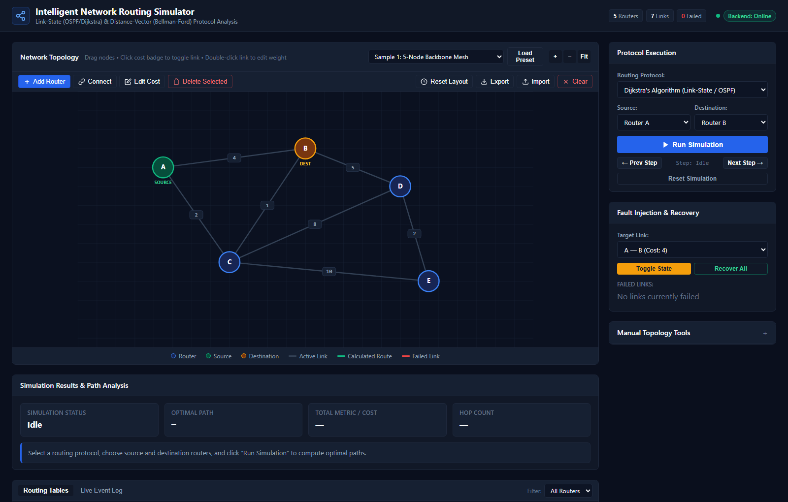
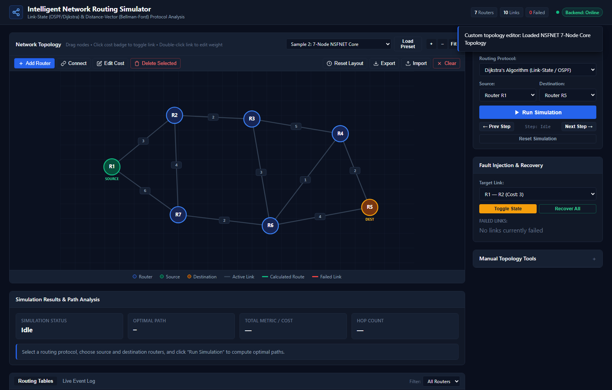
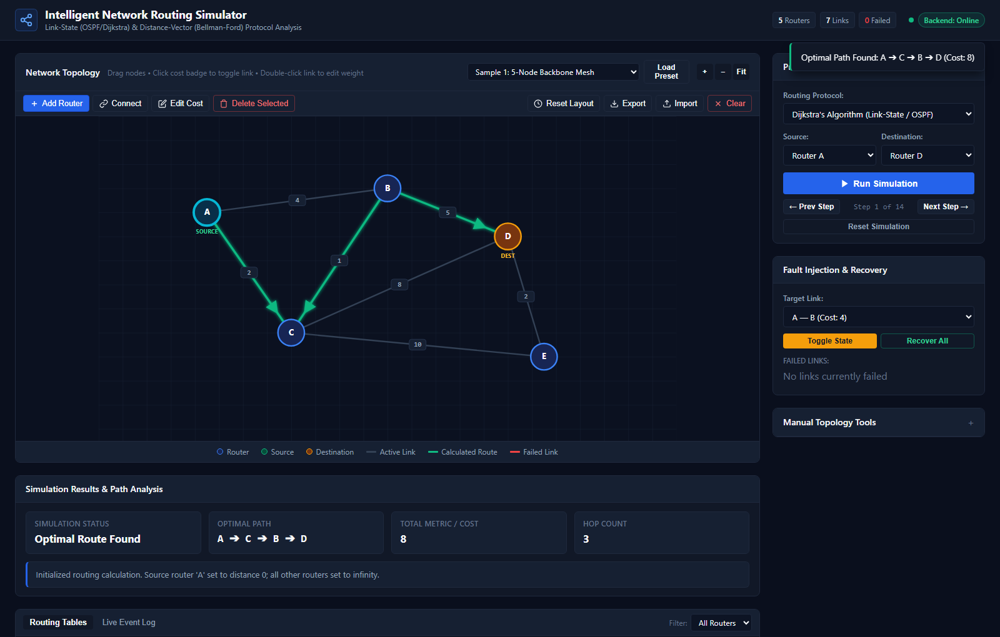
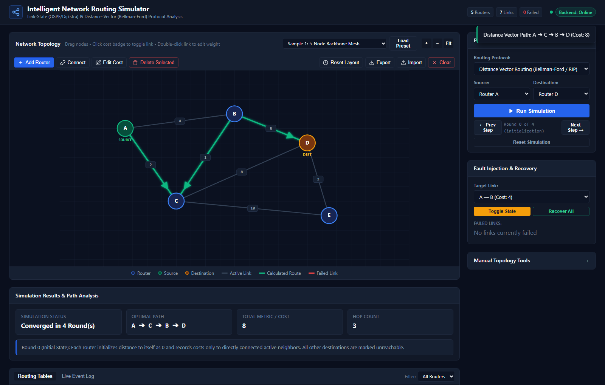
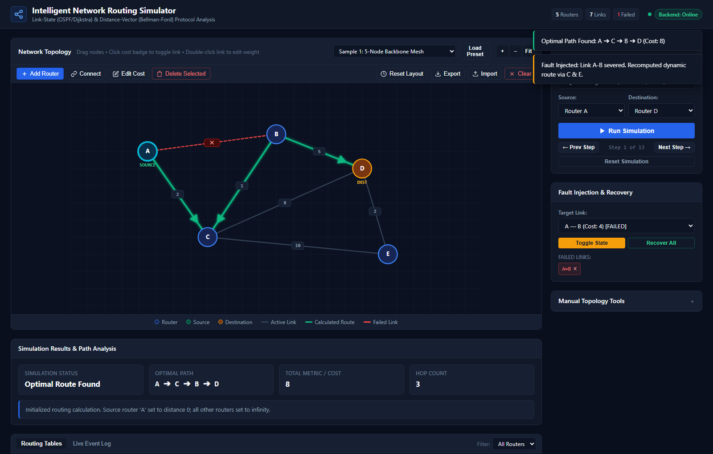
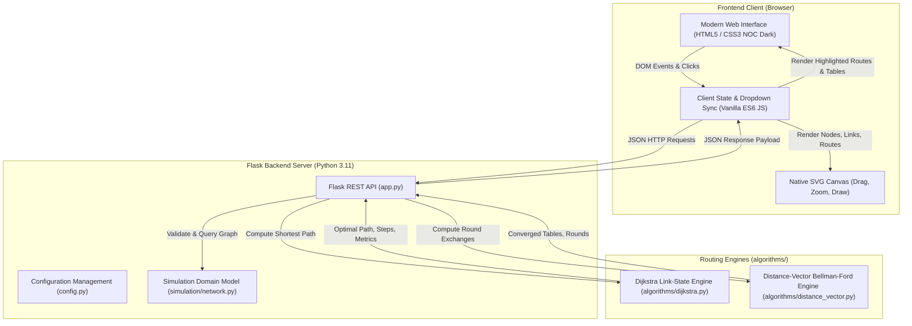

# Intelligent Network Routing Simulator

[](LICENSE)
[](https://www.python.org/)
[](https://flask.palletsprojects.com/)
[](tests/)
[](templates/index.html)

An interactive, high-performance computer networking simulation and visual analysis platform designed to demonstrate, benchmark, and compare fundamental network routing protocols: **Dijkstra's Link-State Shortest Path Algorithm (OSPF)** and the **Distance-Vector Bellman-Ford Routing Protocol (RIP)**.

Developed strictly with **Python 3**, **Flask**, **Vanilla JavaScript (ES6)**, **Native SVG**, and **CSS3**, adhering to clean architectural boundaries with **zero external JavaScript frameworks**, **zero node package dependencies**, and **no heavyweight external database requirements**.

---

## Visual Walkthrough & Screenshots

### 1. Interactive Operations Dashboard & Topology Canvas
*Default 5-node redundant backbone mesh topology rendered with native SVG, displaying dynamic node coordinates, active link weights, network status badges, and inspection tabs.*



---

### 2. Custom Visual Topology Builder
*Interactive drag-and-drop network topology editor demonstrating custom node creation, dynamic link connection, metric configuration, and built-in preset topologies (7-Node NSFNET Core).*



---

### 3. Dijkstra's Link-State Shortest Path Calculation
*Real-time shortest path computation from Router A to Router D. The optimal path (`A → C → B → D`, Metric: 8, Hops: 3) is highlighted with animated directional emerald indicators.*



---

### 4. Distance-Vector (Bellman-Ford) Convergence & Routing Tables
*Round-based distributed vector exchange simulation demonstrating iterative convergence across 4 rounds with per-router forwarding tables.*



---

### 5. Fault Injection & Dynamic Route Recovery
*Real-time link failure simulation on primary link A-B (highlighted in dashed red with fault markers) triggering automatic dynamic re-routing via secondary paths.*



---

## Table of Contents
1. [Abstract](#abstract)
2. [Problem Statement](#problem-statement)
3. [System Architecture](#system-architecture)
4. [Technology Stack](#technology-stack)
5. [System Requirements](#system-requirements)
6. [Project Structure](#project-structure)
7. [Installation & Setup on Windows](#installation--setup-on-windows)
8. [Running the Application](#running-the-application)
9. [Application Usage Guide](#application-usage-guide)
10. [REST API Documentation](#rest-api-documentation)
11. [Routing Algorithm Details](#routing-algorithm-details)
12. [Automated Testing Suite](#automated-testing-suite)
13. [Limitations & Future Scope](#limitations--future-scope)
14. [License](#license)

---

## Abstract

Modern telecommunication and computer networks rely on distributed routing protocols to dynamically navigate data packets across interconnected networks. Understanding how interior gateway protocols compute optimal paths, exchange routing tables, and react to topological failures is a core learning objective in Computer Networks curricula. 

The **Intelligent Network Routing Simulator** bridges theoretical concepts and practical comprehension by providing a visual, interactive simulation engine. It enables users to design custom network topologies, load standardized network graphs, simulate link failures in real time, step through algorithm state snapshots, and inspect dynamic routing tables computed by genuine Python backend algorithms.

---

## Problem Statement

Traditional networking education relies heavily on static whiteboard graphs, mathematical abstractions, or overly complex production emulators (such as Cisco Packet Tracer or GNS3) that require heavy installations, proprietary licensing, or significant hardware resources. Students often struggle to visualize:
1. How Dijkstra's algorithm iteratively explores tentative nodes and relaxes weighted links.
2. How the Distance-Vector protocol propagates path vectors across discrete neighbor exchanges to achieve global network convergence.
3. How real-time link degradation or failure forces immediate alternate route selection and alters per-router next-hop forwarding tables.

This project solves this by delivering a lightweight, zero-dependency, locally hosted web simulator that renders topologies in native SVG and visualizes both Link-State and Distance-Vector protocols step-by-step.

---

## System Architecture



---

## Technology Stack

| Layer | Technology | Rationale |
|---|---|---|
| **Backend Framework** | Python 3.11 & Flask 3.1.3 | Lightweight, standards-compliant WSGI framework for serving REST APIs and static templates |
| **Routing Engines** | Pure Python 3 (`algorithms/`) | Mathematical graph modeling, priority extraction, and round-based distributed state tracking |
| **Frontend UI** | Semantic HTML5 & CSS3 | Clean, responsive Network Operations Center (NOC) dark theme without external CSS frameworks |
| **Graph Visualization** | Native Scalable Vector Graphics (SVG) | High-performance, resolution-independent vector rendering with DOM event listeners for drag-and-drop |
| **Client Scripting** | Vanilla ES6 JavaScript | Native Fetch API for asynchronous JSON communication with Flask endpoints |
| **Test Automation** | pytest 9.1.1 | Automated unit and integration test suite covering algorithms, API schemas, and failure workflows |
| **Environment Management** | Python `venv` & `requirements.txt` | Clean, reproducible virtual environment without global pollution |

---

## System Requirements

- **Operating System**: Microsoft Windows 10 or Windows 11 (AMD64), Linux, or macOS
- **Python**: Version 3.10, 3.11, or 3.12 (Tested on Python 3.11.9)
- **Web Browser**: Any modern browser (Google Chrome, Microsoft Edge, Mozilla Firefox) supporting SVG and ES6
- **Disk Space**: < 50 MB (including virtual environment)
- **Memory**: Minimum 512 MB RAM

---

## Project Structure

```text
Intelligent-Network-Routing-Simulator/
│
├── .gitignore                     # Git ignore rules for caches, OS files, and venv
├── LICENSE                        # Standard MIT License
├── README.md                      # Complete architectural and execution documentation
├── PROJECT_REPORT.md              # Comprehensive 21-section college project report
├── DEMO_SCRIPT.md                 # 5-minute timed viva presentation walkthrough
├── VIVA_PREPARATION.md            # Comprehensive viva questions and technical answers
├── app.py                         # Flask application factory, routes & error handlers
├── config.py                      # Development and Testing environment configuration
├── requirements.txt               # Pinned direct dependencies (Flask, pytest, Werkzeug)
│
├── algorithms/                    # Pure routing algorithm engines
│   ├── __init__.py
│   ├── dijkstra.py                # Dijkstra's shortest path with step trace generator
│   └── distance_vector.py         # Distance-Vector Bellman-Ford round simulation
│
├── docs/                          # Project documentation and visual assets
│   └── screenshots/               # Verified real application captures (1080p)
│       ├── 01-dashboard.png
│       ├── 02-custom-topology.png
│       ├── 03-dijkstra-shortest-path.png
│       ├── 04-distance-vector-routing.png
│       └── 05-link-failure-recovery.png
│
├── scripts/                       # Automation and helper utilities
│   └── capture_screenshots.py     # Automated Chrome headless screenshot capture
│
├── simulation/                    # Graph topology and network state models
│   ├── __init__.py
│   └── network.py                 # NetworkGraph domain class & failure management
│
├── static/                        # Frontend assets
│   ├── css/
│   │   └── style.css              # Custom NOC dark stylesheet & animation tokens
│   └── js/
│       ├── app.js                 # Frontend application coordinator & API integration
│       └── topology.js            # Native SVG canvas renderer, presets & drag-and-drop
│
├── templates/
│   └── index.html                 # HTML5 single-page application shell with SVG canvas
│
└── tests/                         # Pytest automated test suite (56 test cases)
    ├── __init__.py
    ├── test_api.py                # REST API, static asset, and HTTP error code tests
    ├── test_dijkstra.py           # Comprehensive Dijkstra algorithm unit tests
    ├── test_distance_vector.py    # Comprehensive Distance-Vector unit tests
    ├── test_simulation_integration.py # Failure lifecycle & re-routing integration tests
    ├── test_topology.py           # Default topology, presets & synchronization tests
    └── test_topology_builder.py   # Topology builder REST endpoints & validation tests
```

---

## Installation & Setup on Windows

### 1. Clone the Repository
```powershell
git clone https://github.com/bankarsamendra04-eng/Intelligent-Network-Routing-Simulator.git
cd Intelligent-Network-Routing-Simulator
```

### 2. Create and Activate Virtual Environment
```powershell
# Create virtual environment
python -m venv .venv

# Activate virtual environment in PowerShell
.\.venv\Scripts\Activate.ps1

# (Or in standard Command Prompt cmd.exe)
# .venv\Scripts\activate.bat
```

### 3. Install Dependencies
```powershell
pip install -r requirements.txt
```

---

## Running the Application

### 1. Launch the Server
```powershell
python app.py
```
*Expected Console Output:*
```text
 * Serving Flask app 'app'
 * Debug mode: on
 * Running on http://127.0.0.1:5000
```

### 2. Access the Application
Open your web browser and navigate to:
```text
http://127.0.0.1:5000/
```

### 3. Server Health Check
To verify server health directly:
```powershell
Invoke-RestMethod -Uri "http://127.0.0.1:5000/api/health"
```

---

## Application Usage Guide

1. **Loading Predefined Sample Topologies**:
   - In the canvas header toolbar under **Sample Preset**, select one of three preconfigured networks:
     - `Sample 1: 5-Node Backbone Mesh`
     - `Sample 2: 7-Node Regional NSFNET Core`
     - `Sample 3: 6-Node Ring with Cross-Links`
   - Click **Load Preset** to render the topology on the canvas.

2. **Custom Visual Topology Builder (Canvas Toolbar)**:
   - **Add Router**: Click **＋ Add Router** on the toolbar to add a new router (`R1`, `R2`, `R3`...).
   - **Interactive Connect Mode**: Click **🔗 Connect** to enter visual connection mode. Click router A, then router B on the canvas, and enter the transmission metric to create the link.
   - **Edit Link Cost**: Click any link line to select it, then click **✏️ Edit Cost** on the toolbar, or **double-click** any link line or weight badge directly on the canvas.
   - **Delete Selected**: Click any router or link to select it, then click **🗑️ Delete Selected** on the toolbar or press the `Delete` key.
   - **Circular Layout Reset**: Click **↺ Reset Layout** to arrange all routers symmetrically in a balanced circular distribution.
   - **Zoom Controls**: Use `+`, `−`, and `Fit` to scale and center large topologies.
   - **Export & Import JSON**:
     - Click **Export** to download the current network structure as a `.json` file.
     - Click **Import** to load and validate any saved JSON network file.
   - **Drag & Reposition**: Click and drag any router on the canvas. Coordinates persist in browser `localStorage`.

3. **Simulating Link Failures & Dynamic Recovery**:
   - **Click Cost Badge to Fail/Recover**: Click directly on any link's centered cost badge on the canvas to instantly toggle its failure state (`[FAILED]` red dashed line).
   - **Dropdown Failure Control**: Select a link under **Fault Injection & Recovery** in the sidebar and click **Toggle State**.
   - **Instant Recovery**: Click the `×` button on any failed link chip or click **Recover All**.

4. **Running Routing Simulations**:
   - Select the desired protocol (**Dijkstra's Algorithm** or **Distance Vector Routing**).
   - Select a **Source Router** and **Destination Router**.
   - Click **▶ Run Simulation**.
   - The optimal path is computed by the Python backend and highlighted in emerald on the canvas.
   - The **Simulation Results & Path Analysis** card displays status, optimal path sequence, total cost, and hop count.
   - The **Routing Tables** panel populates forwarding entries for all routers.

5. **Step-by-Step Algorithm Playback**:
   - Click **Next Step (&rarr;)** to step through node relaxations (in Dijkstra) or round-by-round vector exchanges (in Distance-Vector).
   - Click **&larr; Prev Step** to step backward.

---

## REST API Documentation

### 1. Health Check
- **Endpoint**: `GET /api/health`
- **Response**: `200 OK`
```json
{
  "service": "Intelligent Network Routing Simulator API",
  "status": "healthy",
  "version": "1.0.0"
}
```

### 2. Network Topology Management API
- **Get Current Topology**: `GET /api/topology`
  - Returns active nodes, active links, and adjacency matrices.
- **Batch Update / Reset**: `POST /api/topology`
  - Accepts `{"reset": true}` or `{"nodes": [...], "links": [...]}`.
- **Add Router**: `POST /api/topology/router`
  - Body: `{"id": "R1", "label": "Core Gateway", "x": 300, "y": 200}`.
- **Update Router**: `PUT /api/topology/router/<id>`
  - Body: `{"label": "New Name", "x": 400, "y": 250}`.
- **Delete Router**: `DELETE /api/topology/router/<id>`
  - Removes router and automatically purges all connected links.
- **Add Link**: `POST /api/topology/link`
  - Body: `{"source": "R1", "target": "R2", "cost": 5, "status": "active"}`.
- **Update Link**: `PUT /api/topology/link/<link_id>`
  - Body: `{"cost": 8, "status": "failed"}`.
- **Delete Link**: `DELETE /api/topology/link/<link_id>`.
- **Clear Graph**: `POST /api/topology/clear`.
- **Load Preset**: `POST /api/topology/sample` with `{"preset": "mesh5" | "nsfnet7" | "ring6"}`.

### 3. Dijkstra Shortest-Path Endpoint
- **Endpoint**: `POST /api/dijkstra`
- **Headers**: `Content-Type: application/json`
- **Request Body**:
```json
{
  "nodes": [{"id": "A"}, {"id": "B"}, {"id": "C"}],
  "edges": [
    {"source": "A", "target": "B", "cost": 4, "active": true},
    {"source": "A", "target": "C", "cost": 1, "active": true},
    {"source": "C", "target": "B", "cost": 1, "active": true}
  ],
  "source": "A",
  "destination": "B"
}
```
- **Response**: `200 OK`
```json
{
  "status": "success",
  "source": "A",
  "destination": "B",
  "reachable": true,
  "path": ["A", "C", "B"],
  "total_cost": 2,
  "hop_count": 2,
  "distances": {"A": 0, "B": 2, "C": 1},
  "next_hops": {"A": null, "B": "C", "C": "C"},
  "routing_table": [
    {"destination": "A", "cost": 0, "next_hop": "-", "status": "Direct"},
    {"destination": "B", "cost": 2, "next_hop": "C", "status": "Reachable"},
    {"destination": "C", "cost": 1, "next_hop": "C", "status": "Reachable"}
  ],
  "steps": [...]
}
```

### 4. Distance-Vector Routing Endpoint
- **Endpoint**: `POST /api/distance-vector`
- **Headers**: `Content-Type: application/json`
- **Request Body**: Same topology format as Dijkstra.
- **Response**: `200 OK`
```json
{
  "status": "success",
  "source": "A",
  "destination": "B",
  "converged": true,
  "total_rounds": 2,
  "iteration_limit_reached": false,
  "path": ["A", "C", "B"],
  "total_cost": 2,
  "hop_count": 2,
  "reachable": true,
  "final_tables": {
    "A": [...],
    "B": [...],
    "C": [...]
  },
  "rounds": [...]
}
```

---

## Routing Algorithm Details

### Dijkstra's Shortest Path Algorithm (Link-State)
- **Concept**: Centralized calculation assuming global knowledge of network topology (analogous to OSPF/IS-IS).
- **Core Formula**:
  $$d(v) = \min(d(v), d(u) + c(u, v))$$
- **Complexity**: $O((V + E) \log V)$ using priority selection.
- **Key Characteristics**: Instantaneous optimal path computation, deterministic tie-breaking, guaranteed loop-free shortest paths.

### Distance-Vector Routing Protocol (Bellman-Ford)
- **Concept**: Distributed iterative routing where routers only communicate with direct physical neighbors (analogous to RIP).
- **Core Formula**:
  $$D_X(Y) = \min_V \{ c(X, V) + D_V(Y) \}$$
- **Complexity**: $O(K \cdot V \cdot E)$ where $K$ is the number of exchange rounds until convergence.
- **Key Characteristics**: Neighbor-only vectors, progressive convergence across network diameter, dynamic route adaptation on link state failure.

---

## Automated Testing Suite

The project includes an automated test suite containing **56 verified test cases** executed via `pytest`:

```powershell
pytest -v
```

### Test Coverage Breakdown:
1. **`tests/test_api.py` (16 tests)**:
   - Health check endpoint verification
   - HTML index dashboard template rendering
   - Static asset serving (CSS and JS files)
   - Dijkstra and Distance-Vector API success payloads
   - Validation handling (missing body, missing source, negative costs, empty nodes)
   - Custom 404 JSON error handler for `/api/*`
   - Custom 405 Method Not Allowed handler for `/api/*`
2. **`tests/test_dijkstra.py` (11 tests)**:
   - Direct link routing
   - Multi-hop alternate path selection
   - Deterministic equal-cost tie-breaking
   - Disconnected / unreachable router detection
   - Source equal to destination ($cost = 0, hops = 0$)
   - Inactive link exclusion
   - Non-positive and invalid weight rejection
   - Self-loop rejection
   - Graph immutability
   - Step trace generation
3. **`tests/test_distance_vector.py` (8 tests)**:
   - Single-hop routing table initialization
   - Multi-hop neighbor vector propagation across rounds
   - Progressive path improvement over time
   - Convergence detection and round limits
   - Partitioned network handling
   - Link failure exclusion
   - Equivalence verification with Dijkstra on identical graphs
4. **`tests/test_simulation_integration.py` (2 tests)**:
   - End-to-end link failure lifecycle (baseline route $\to$ link fail $\to$ alternate route $\to$ partition $\to$ link recovery) on both domain models and Flask REST endpoints.
5. **`tests/test_topology.py` (5 tests)**:
   - Default graph schema and instantiation
   - Single-router topology calculations
   - Link toggle and full recovery
   - Custom topology POST updates
6. **`tests/test_topology_builder.py` (14 tests)**:
   - Router creation with auto-generated sequential IDs (`R1`, `R2`...)
   - Custom router identifiers, coordinate updates, and duplicate rejection
   - Dynamic link creation, positive weight validation, and self-loop rejection
   - Link weight modification and active/failed status toggle
   - Router deletion and cascading incident link purging
   - Graph clearing and sample presets (`mesh5`, `nsfnet7`, `ring6`)
   - Complete end-to-end custom triangle network construction and dual-algorithm routing verification.

---

## Limitations & Future Scope

### Educational Assumptions
1. **Synchronous Distance-Vector Rounds**: Modeled as discrete synchronous iterations rather than asynchronous RIP UDP broadcasts with network latency jitter.
2. **Hop Metric Domain**: Supports positive integer/decimal metrics (e.g., latency in milliseconds or administrative cost) rather than strictly limiting hop counts to 15 as in RFC 1058 RIP.
3. **Static Cost Metric**: Link costs remain static unless manually altered or failed by the user.

### Future Enhancements
- Support for **Split Horizon with Poison Reverse** visualization during counting-to-infinity demonstrations.
- Interactive **packet transmission animation** displaying individual IP packets transiting router interfaces.
- Support for **OSPF Multi-Area Hierarchies** (Backbone Area 0, Stub Areas).
- Dynamic bandwidth/traffic congestion simulation with dynamic latency based on link saturation.

---

## License

This project is licensed under the **MIT License** — see the [LICENSE](LICENSE) file for details.

Copyright (c) 2026 **bankarsamendra04-eng**.
